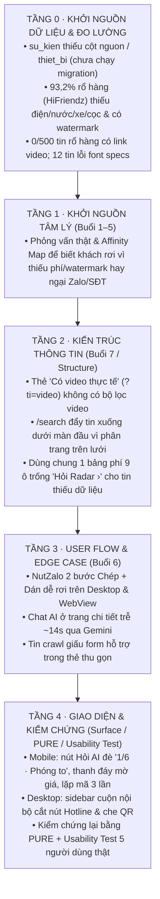

# 08 · Kế hoạch điều tra & sửa lỗi UX theo thứ tự Khởi nguồn -> Kéo theo (11/2026)

> Nguyên tắc cốt lõi (theo khung DAS UX Research & Strategy + Jesse James Garrett 5 Elements of UX):
> **Không sửa triệu chứng bề mặt (`Surface`) trước khi kiểm chứng gốc rễ (`Dữ liệu & Đo lường` -> `Nghiên cứu hành vi` -> `Kiến trúc thông tin` -> `User Flow`).**

---

## Sơ đồ nhân quả (Khởi nguồn -> Kéo theo)

---

## Giai đoạn 0 · KHỞI NGUỒN DỮ LIỆU & ĐO LƯỜNG (Làm trước tiên)

**Mục tiêu:** Đảm bảo công cụ đo nhìn đúng người thật và biết rõ kho dữ liệu nguồn thực sự có gì trước khi thiết kế cách hiển thị.

- [ ] **0.1. Bật đủ đo nguồn (`nguon`) & thiết bị (`thiet_bi`) trong `su_kien`:**
  - Đã kiểm tra Supabase production REST API: cả 3 migration `037_gioi_han_xem_sdt.sql` (`PGRST202 public.lay_sdt_tin`), `038_khoa_ghi_va_gioi_han.sql` (`PGRST205 public.gioi_han_luot`), và `039_su_kien_nguon.sql` (`42703 column su_kien.nguon does not exist`) **chưa được chạy trong Supabase SQL Editor**.
  - Chờ chạy `039` trước (an toàn ngay lập tức), sau khi deploy bản web mới mới chạy `037` và `038`.
- [ ] **0.2. Lọc nhiễu nội bộ & bot khỏi dữ liệu hành vi:**
  - Đã xác nhận `src/app/api/su-kien/route.ts` đã bỏ qua phiên admin (`laAdmin`).
  - Cần mở GA4 + Microsoft Clarity để tách đột biến 790 lượt/790 `khach` ngày 05/11 khỏi 10–21 khách thật/ngày.
- [x] **0.3. Rà soát & sửa nguồn gốc dữ liệu HiFriendz, Video & Mojibake (`ro_hang`):**
  - Probe live RSC `https://hifriendz.com/du-an/<id>` xác nhận `detailsById[roomId]` có đủ `fees` (Điện, Nước, Gửi xe, Dịch vụ), `regulations` (Cọc, Hợp đồng, Số người, Thú cưng, Giờ giấc), `furniture`, `amenities`. Đã cập nhật `crawler/hifriendz-fetch.mjs` và test live 3 tòa (11/11 phòng đạt 4/4 khoản phí và 4–5/5 điều khoản; chờ chạy full trên máy 146).
  - Xác nhận 3.538 tin `published` (5.371 tin mọi trạng thái) đã có link video (`.mp4`...) trong `images` nhưng thiếu khóa `"video"` trong `amenities`. Đã cập nhật `crawler/ro-hang-evohome.mjs` và backfill xong **3.538 tin `published`** trên Supabase.
  - Đã sửa dứt điểm lỗi mã hóa `?` mojibake trên toàn bộ **12 tin** `doc_quyen_270_thong_nhat_*` (`province`, `district`, `address`, `title`, `description`, `specs`, `furnishing`, `poster_reasons`, và `listing_ro_hang`: còn `0` lỗi `?`).
- [ ] **0.4. Kiểm tra Clarity Recordings & lỗi màn trắng `/dashboard/new`:**
  - Đã rà `src/app/dashboard/new/` và xác nhận `src/app/` chưa có `error.tsx` nào (khi gặp lỗi client như xung đột DOM từ Google Dịch sẽ hiện lỗi chung). Cần soi thêm Microsoft Clarity JS errors và tạo `app/error.tsx` có log về `su_kien`.

**Tiêu chí hoàn thành Giai đoạn 0:** Biết rõ tỷ lệ Mobile/PC theo từng nguồn truy cập, chốt được danh sách trường dữ liệu thật sự khai thác được từ HiFriendz/EvoHome.

---

## Giai đoạn 1 · KHỞI NGUỒN HÀNH VI (Buổi 1–5: Interview -> Synthesize -> Persona & Journey Map)

**Mục tiêu:** Thay toàn bộ giả thuyết `[SUY]` / `[GIẢ ĐỊNH]` trong `docs/ux/02..06` bằng bằng chứng phỏng vấn thật.

- [ ] **1.1. Sửa kịch bản phỏng vấn (`05-research-plan.md`) theo chuẩn Buổi 3:** Dùng 5W1H (tập trung 60–80% cho *How* và *Why*), tuân thủ 4 quy tắc (*Mở, Trung lập, Quá khứ, Trải nghiệm*), loại bỏ câu hỏi dẫn dắt hoặc hỏi tương lai giả định.
- [ ] **1.2. Phỏng vấn 2 nhóm `Manage Closely` (Power × Interest, Buổi 4):**
  - **5–6 khách thuê:** Người từng xem >= 3 tin rồi thoát hoặc từng nhắn Zalo / để lại SĐT. Xác minh phản ứng thật với logo watermark `HiFriendz`, bảng `1/5 khoản phí`, nút `Zalo` (bước Dán mã) và ô SĐT 1 chạm mới.
  - **2–3 chủ trọ / đối tác rổ hàng:** Kiểm tra khả năng cung cấp bảng phí chuẩn & video quay sẵn theo tòa nhà.
- [ ] **1.3. Tổng hợp Affinity Mapping (KJ Method) & cập nhật Persona / Journey Map (Buổi 4–5):**
  - Nhóm sticky notes theo ý nghĩa (kèm mã `P01..`, giữ cả ý kiến trái chiều), tổng hợp trong 24–48h.
  - Viết lại **Problem Statement**: `[Người thuê] cần [nhu cầu] vì [insight thật]`.
  - Xác định lại **Moment of Truth** trên Journey Map -> rút ra danh sách **How Might We (HMW)** và chấm **Impact × Effort**.

---

## Giai đoạn 2 · KÉO THEO 1: KIẾN TRÚC THÔNG TIN (Buổi 7 · Information Architecture & Scope)

**Mục tiêu:** Cấu trúc danh mục, bộ lọc và phân tầng nội dung trên trang khớp 100% với dữ liệu thật, không hứa sai.

- [ ] **2.1. Kiểm toán toàn bộ link & chip dẫn vào từ Trang chủ (`src/app/page.tsx`):**
  - Đã thêm khóa `"video"` vào `TIEN_ICH` + kiểm tra URL video trong `tienIchCua` (`src/lib/tien-ich.ts`) để link `/search?deal=cho_thue&ti=video` từ thẻ *"Có video thực tế"* lọc đúng danh sách phòng có video thật.
  - Còn làm: kiểm tra đồng nhất số tin giữa Trang chủ (`14.034`) và `/search?deal=cho_thue` (`13.816`, đang tự áp tỉnh TP.HCM); rà lại toàn bộ link khu vực, trường ĐH, metro, mức giá.
- [x] **2.2. Sắp xếp lại ưu tiên màn hình đầu `/search` (`src/app/search/SearchClient.tsx`):** Đã ẩn thanh phân trang phía trên lưới kết quả trên mobile (`hidden sm:block`), giữ phân trang dưới lưới để thẻ phòng hiện ngay trong màn hình đầu mobile.
- [ ] **2.3. Thiết kế 3 mẫu hiển thị tin theo độ đủ dữ liệu (`src/app/listings/[id]/page.tsx`):**
  - Đã xử lý tin rổ hàng đủ phí (5/5) & tin thiếu phí (`!coPhiPhu` / `!coDieuKhoan`): bỏ 9 dòng `Hỏi Radar ›` trống trải, giữ dòng `Tiền phòng` + ghi chú trung thực + 1 CTA Zalo gọn; bảng phí đầy đủ giữ nguyên.
  - Còn làm: thiết kế riêng khối nguồn gốc & đường liên hệ rõ ràng hơn cho nhóm tin `crawl` / `zalo_miniapp`.
- [ ] **2.4. Quét kiến trúc các trang phụ:** `/nha-dat-ban`, `/projects/[id]`, `/dinh-gia`, `/lap-phong`, `/yeu-thich`, `/auth`.

---

## Giai đoạn 3 · KÉO THEO 2: USER FLOW & EDGE CASE (Buổi 6 · Nhánh quyết định & Lối thoát)

**Mục tiêu:** Đảm bảo 5 luồng chính không còn điểm đứt gãy, không có ngõ cụt (theo checklist *Nhánh lỗi & edge case*: đủ nhánh Có/Không, mọi lỗi đều có lối ra).

- [ ] **3.1. Flow Google/Ads -> Chi tiết tin -> Chuyển đổi:** Kiểm tra hành vi tin hết hạn (`gone`, 301 về khu vực), xử lý khi khách muốn so sánh 2–3 căn (`/yeu-thich`).
- [ ] **3.2. Flow `NutZalo` (`src/components/TheoDoi.tsx`):** Đo tỷ lệ rơi trên Desktop (màn trung gian `zalo.me`) và Mobile WebView (clipboard fallback). Bổ sung giải pháp sao cho dù không mở Zalo vẫn giữ được lead (liên thông với ô SĐT 1 chạm).
- [ ] **3.3. Flow Form SĐT gọi lại -> Zalo bot 146 (`actions.ts` -> `crawler/zalo-bot.mjs`):** Kiểm thử đủ case nhập sai định dạng (`+84`, dấu cách), spam rate-limit, mở rộng ô gọi lại cho tin `crawl` nếu hợp lý.
- [ ] **3.4. Flow Trợ lý AI (`ChatWidget.tsx`, `ChatPanel.tsx`, `/api/chat/route.ts`):** Bổ sung xử lý nhanh cho ngữ cảnh **đang xem tin (`dangXem`)** (hỏi còn phòng không / hỏi phí / hẹn xem) để không phải đợi ~14s qua Gemini, đồng thời có lối ra mượt khi lỗi/hết quota.
- [ ] **3.5. Flow Trang chủ / `/search` Mobile Bottom Bar (`ChatWidget.tsx`):** Kiểm tra xem thanh đáy `Gọi ngay | Zalo | AI` khi khách chưa chọn phòng có gây áp lực sớm làm tăng tỷ lệ thoát không.

---

## Giai đoạn 4 · KÉO THEO 3: BỀ MẶT GIAO DIỆN & KIỂM CHỨNG (Heuristic, PURE & Usability Test)

**Mục tiêu:** Sửa dứt điểm các lỗi hiển thị/che khuất trên mọi khổ màn hình và xác nhận bằng người dùng thật sau khi hoàn tất Giai đoạn 0–3.

- [ ] **4.1. Sửa các lỗi va chạm UI đã ghi nhận:**
  - Đã sửa trên [`Gallery.tsx`](src/components/Gallery.tsx) & [`listings/[id]/page.tsx`](src/app/listings/[id]/page.tsx) (kiểm tra thực tế Chrome `390×844` và `1440×900`): dời `1/6 · Phóng to` sang `bottom-3 left-3 sm:left-auto sm:right-3` và chấm slide mobile sang `bottom-3 right-3 sm:right-auto sm:left-1/2` (tránh đè `Hỏi AI`), đổi thanh dính đáy mobile sang nền đặc `bg-[var(--surface)]`, bỏ lặp `NutChepMa` trên thanh đáy, bỏ `lg:overflow-y-auto` ở cột phải desktop để không cắt nút Hotline & QR Zalo.
  - Còn làm: thêm nhãn rõ cho nút chuông `SaveSearchButton` bản gọn trên `/search`, và chốt phương án xử lý watermark ảnh HiFriendz theo kết luận Giai đoạn 1.
- [ ] **4.2. Kiểm tra đa khổ & đa giao diện:** `375×812`, `390×844`, `768×1024`, `1440×900`, cả Light mode lẫn Dark mode.
- [ ] **4.3. Chấm điểm PURE lại toàn bộ 5 Flow:** Xác nhận không còn bước nào mức điểm `3` (tắc/bỏ cuộc).
- [ ] **4.4. Usability Test (Assessment Test — 5 người dùng thật):** Chạy 3 task ngữ cảnh thực tế trên điện thoại cá nhân của người tham gia (Tìm & lọc -> Đọc tin & kiểm tra tổng chi phí -> Chốt liên hệ), chấm điểm dễ dùng **SEQ (1–5)** và đối chiếu **Clarity Dead Clicks + tỷ lệ `leads` / `xem` trong `su_kien`** sau 7 ngày.
